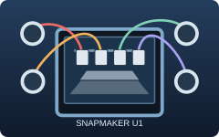
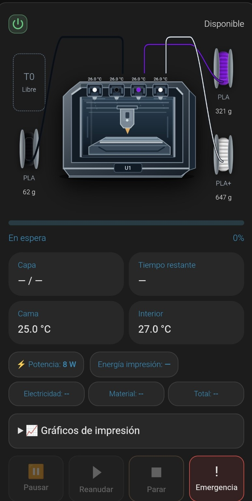
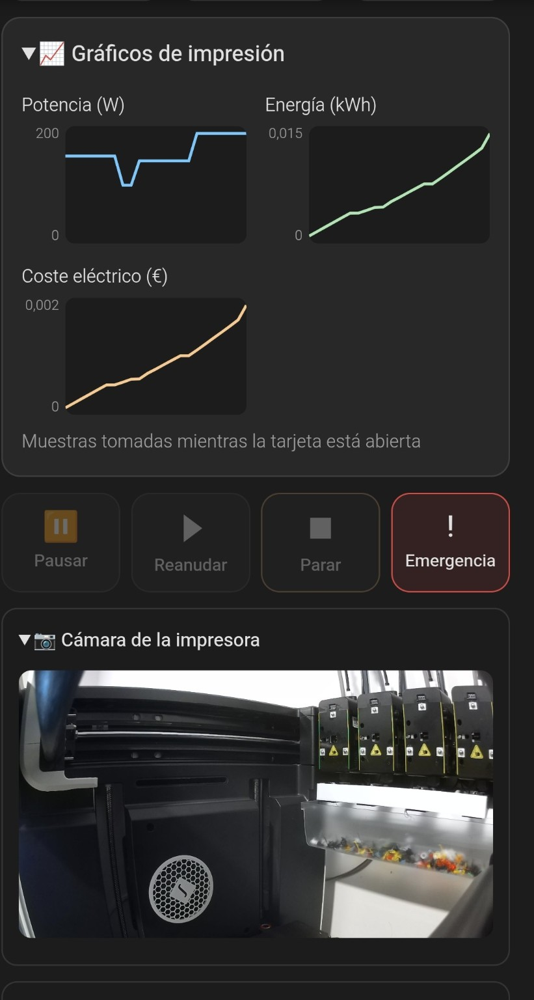
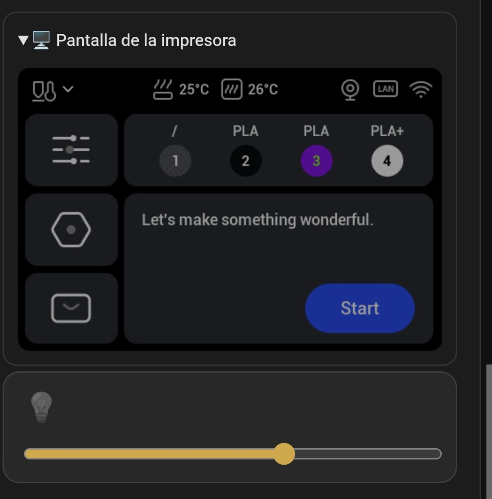
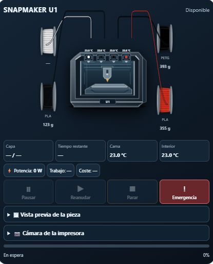
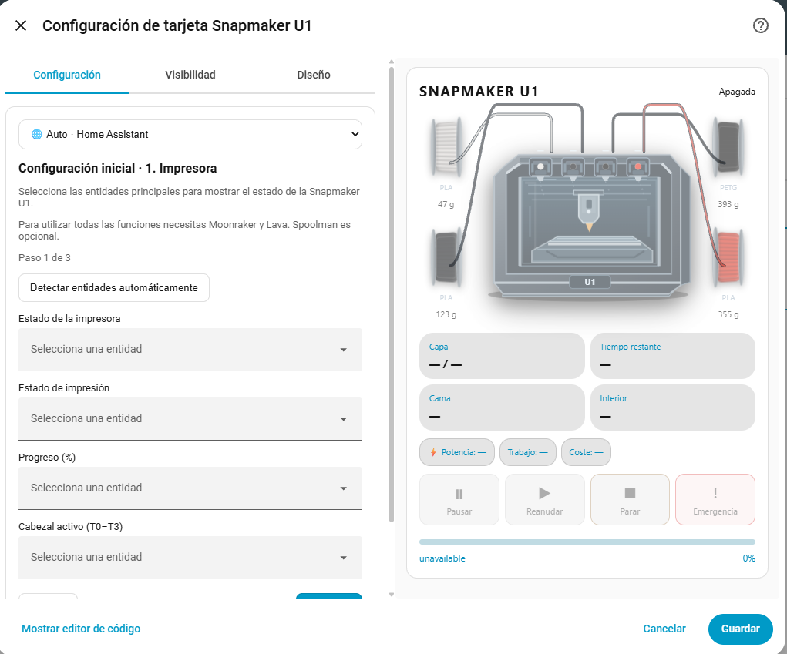
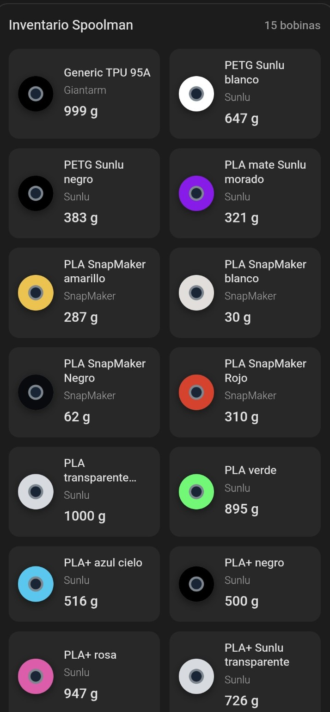

# Snapmaker U1 Card

[English](#english) · [Español](#español)

<a id="english"></a>

# English

A Home Assistant dashboard card for the Snapmaker U1: monitor printing, four toolheads, filament, cameras and energy, and use compatible printer controls from one card.

<p align="center"></p>

[](https://my.home-assistant.io/redirect/marketplace_repository/?owner=sergey08&repository=snapmaker-u1-card&category=plugin)

## Latest release: v0.1.16

This release uses a compact illustration (240 × 150 px) in the catalog. It includes the previously released v0.1.15 picker localization and preview improvements. See [v0.1.16 release notes](docs/releases/v0.1.16.md) and [GitHub Releases](https://github.com/sergey08/snapmaker-u1-card/releases).

## Card languages

The card supports **English (`en`), Español (`es`), Français (`fr`), Deutsch (`de`), Italiano (`it`), Português (`pt`) and Nederlands (`nl`)**. It detects the Home Assistant language automatically, or you can choose a supported language in the editor. Unsupported languages fall back to English. Some translations are still under review. This README is in English and Spanish.

## Features

- Four toolheads (T0–T3), temperatures, active tool and filament information.
- Print status, progress, layers, estimated time and current-job thumbnail.
- Optional camera, Spoolman inventory and filament colours and weights.
- Optional power, energy and estimated electricity cost.
- Compatible print controls, with confirmation for destructive actions.
- Optional printer light control with a bulb button and 0–100% brightness slider.
- Optional update notice, shown only when the configured sensor indicates an update.
- Visual editor, three-step setup wizard and read-only entity auto-detection.
- Light and dark Home Assistant themes, with full and compact layouts.

## Requirements

| Component | Requirement | Purpose |
| --- | --- | --- |
| Home Assistant | Required | Dashboard and entities |
| [Moonraker for Home Assistant](https://github.com/marcolivierarsenault/moonraker-home-assistant) | Required for core printing features | Status, progress, temperatures and compatible controls |
| [Lava / U1 Companion](https://github.com/zkasuran/u1-companion) | Required for full U1-specific functionality | Toolhead and filament information |
| [Spoolman](https://github.com/Donkie/Spoolman) | Optional | Inventory, colours and remaining filament |
| Camera and electricity entities | Optional | Camera, energy and cost |

Installing the card does not install or configure these integrations. Without Spoolman, compatible core printing functions can still work.

## Install from the Marketplace

Snapmaker U1 Card is in the default catalog of the Marketplace, built into Home Assistant 2026.11 and later.

1. Open **Settings → Marketplace** and search for **Snapmaker U1 Card**, or use the **Open in Marketplace** badge above.
2. Open the card’s page, select **Install** and confirm.
3. Reload your browser, edit your dashboard and select **Snapmaker U1 Card** from the card picker. You can also add it in YAML.

```yaml
type: custom:snapmaker-u1-card
```

In the wizard, select **Auto-detect entities**, review the matches and configure optional entities in the editor.

If you manage dashboard resources in YAML, add the JavaScript module shown in the Marketplace install dialog.

Home Assistant 2026.11 automatically migrates existing HACS installations of this card to the Marketplace.

For a development preview, expose the JavaScript file as a Lovelace module resource. An isolated DEV build may use the separate `snapmaker-u1-card-dev` element. Load one resource per custom element.

## Screenshots

The setup preview may show unavailable values until entities are configured.

### Full dashboard






### Compact mode


### Setup wizard


### Spoolman inventory


## Configuration examples

All entities below are optional; replace them with your own. An empty title hides the title.

```yaml
type: custom:snapmaker-u1-card
gui_camera: camera.gui_snapmaker_u1_despacho_2
gui_open_default: false
daily_energy_sensor: sensor.impresora3d_energy_today
led_light_entity: light.led_cavity_led_snapmaker_u1_despacho
update_available_sensor: binary_sensor.update_available_lava
title: ""
```

The GUI camera is read-only. The LED entity must support Home Assistant light services; brightness depends on the integration. A brightness of 0% turns the light off. The update banner appears when the configured binary sensor is on.

## Safety, development and releases

Automatic detection only reads Home Assistant state. Printer controls can perform real actions: check entity mappings before using them. The wizard and automatic detection have been tested in one Home Assistant installation; translation coverage, browsers, live-print controls and multi-printer setups need further validation.

Develop on a separate branch and test in an isolated Home Assistant environment. The Marketplace entry point is `snapmaker-u1-card.js`; do not publish development commits as releases. The beta workflow uses `v*-beta.*` tags and the manually triggered [stable release workflow](.github/workflows/stable-release.yml) publishes a versioned release after acceptance. See [BETA_CHECKLIST.md](BETA_CHECKLIST.md). Do not publish before review and acceptance are complete.

Earlier v0.1.2–v0.1.5 notes and previous documentation are preserved in [the README archive](docs/README-history-archive.md). For issues or suggestions use [GitHub Issues](https://github.com/sergey08/snapmaker-u1-card/issues).

**License:** MIT.

---

<a id="español"></a>

# Español

Tarjeta de Home Assistant para la Snapmaker U1: consulta la impresión, los cuatro cabezales, filamentos, cámaras y energía, y utiliza los controles compatibles desde un único panel.

<p align="center"></p>

[](https://my.home-assistant.io/redirect/marketplace_repository/?owner=sergey08&repository=snapmaker-u1-card&category=plugin)

## Última versión: v0.1.16

Esta versión usa una ilustración compacta (240 × 150 px) en el catálogo. Incluye las mejoras ya publicadas en v0.1.15 del selector multidioma y la vista previa. Consulta las [notas de v0.1.16](docs/releases/v0.1.16.md) y [GitHub Releases](https://github.com/sergey08/snapmaker-u1-card/releases).

## Idiomas de la tarjeta

La tarjeta admite **inglés (`en`), español (`es`), francés (`fr`), alemán (`de`), italiano (`it`), portugués (`pt`) y neerlandés (`nl`)**. Detecta automáticamente el idioma de Home Assistant o permite elegir uno compatible en el editor. Si el idioma no es compatible, utiliza inglés. Algunas traducciones siguen en revisión. Este README está disponible en inglés y español.

## Funcionalidades

- Cuatro cabezales (T0–T3), temperaturas, herramienta activa y filamento.
- Estado, progreso, capas, tiempo estimado y miniatura del trabajo actual.
- Cámara, inventario Spoolman, colores y pesos de filamento opcionales.
- Potencia, energía y coste eléctrico estimado opcionales.
- Controles de impresión compatibles, con confirmación para acciones destructivas.
- Control opcional de luz mediante bombilla y barra de brillo de 0 a 100 %.
- Aviso de actualización opcional, visible solo cuando el sensor configurado la indica.
- Editor visual, asistente de tres pasos y detección de entidades de solo lectura.
- Adaptación a temas claro y oscuro de Home Assistant, con modo completo y compacto.

## Requisitos

| Componente | Necesidad | Función |
| --- | --- | --- |
| Home Assistant | Obligatorio | Panel y entidades |
| [Moonraker para Home Assistant](https://github.com/marcolivierarsenault/moonraker-home-assistant) | Necesario para las funciones principales | Estado, progreso, temperaturas y controles compatibles |
| [Lava / U1 Companion](https://github.com/zkasuran/u1-companion) | Necesario para todas las funciones específicas de U1 | Información de cabezales y filamentos |
| [Spoolman](https://github.com/Donkie/Spoolman) | Opcional | Inventario, colores y filamento restante |
| Entidades de cámara y electricidad | Opcionales | Cámara, energía y coste |

Instalar la tarjeta no instala ni configura estas integraciones. Sin Spoolman pueden seguir funcionando las funciones principales compatibles.

## Instalar desde el Marketplace

Snapmaker U1 Card está en el catálogo predeterminado del Marketplace, integrado en Home Assistant desde la versión 2026.11.

1. Abre **Ajustes → Marketplace** y busca **Snapmaker U1 Card**, o usa el botón **Abrir en Marketplace** de arriba.
2. Abre la ficha de la tarjeta, pulsa **Instalar** y confirma.
3. Recarga el navegador, edita tu panel y elige **Snapmaker U1 Card** en el selector de tarjetas. También puedes añadirla en YAML.

```yaml
type: custom:snapmaker-u1-card
```

En el asistente, selecciona **Detectar entidades automáticamente**, revisa las coincidencias y configura las entidades opcionales en el editor.

Si gestionas los recursos del panel en YAML, añade el módulo JavaScript que indica el cuadro de instalación del Marketplace.

Home Assistant 2026.11 migra automáticamente al Marketplace las instalaciones de esta tarjeta hechas con HACS.

Para una prueba de desarrollo, añade el archivo JavaScript como recurso Lovelace de tipo módulo. Una compilación DEV aislada puede utilizar el elemento independiente `snapmaker-u1-card-dev`. Carga un solo recurso por elemento personalizado.

## Capturas de pantalla

La vista previa del asistente puede mostrar valores no disponibles hasta configurar las entidades.

### Vista completa


### Modo compacto


### Asistente de configuración


### Inventario Spoolman


## Ejemplos de configuración

Todas las entidades siguientes son opcionales; sustitúyelas por las tuyas. Un título vacío oculta el título.

```yaml
type: custom:snapmaker-u1-card
gui_camera: camera.gui_snapmaker_u1_despacho_2
gui_open_default: false
daily_energy_sensor: sensor.impresora3d_energy_today
led_light_entity: light.led_cavity_led_snapmaker_u1_despacho
update_available_sensor: binary_sensor.update_available_lava
title: ""
```

La cámara GUI es de solo lectura. La entidad LED debe admitir los servicios de luz de Home Assistant; la regulación depende de la integración. El brillo al 0 % apaga la luz. El aviso aparece cuando el sensor binario configurado está activado.

## Seguridad, desarrollo y versiones

La detección automática solo consulta estados de Home Assistant. Los controles pueden ejecutar acciones reales: revisa las entidades antes de utilizarlos. El asistente y la detección se han probado en una instalación de Home Assistant; quedan por ampliar las pruebas de traducciones, navegadores, controles durante impresión y configuraciones con varias impresoras.

Desarrolla en una rama independiente y prueba en un entorno aislado de Home Assistant. El archivo que instala el Marketplace es `snapmaker-u1-card.js`; no publiques commits de desarrollo como versiones. El flujo beta utiliza etiquetas `v*-beta.*` y el [flujo de versión estable](.github/workflows/stable-release.yml), de ejecución manual, publica una versión después de la aceptación. Consulta [BETA_CHECKLIST.md](BETA_CHECKLIST.md). No publiques antes de completar la revisión y la aceptación.

Las notas anteriores de v0.1.2–v0.1.5 y la documentación previa se conservan en el [archivo del README](docs/README-history-archive.md). Para errores o propuestas, utiliza [GitHub Issues](https://github.com/sergey08/snapmaker-u1-card/issues).

**Licencia:** MIT.
