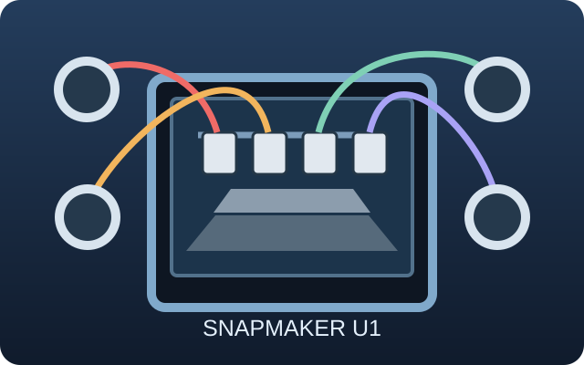
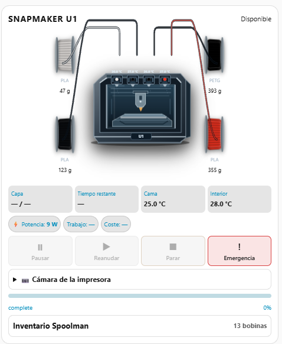
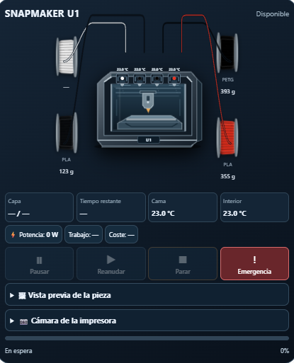
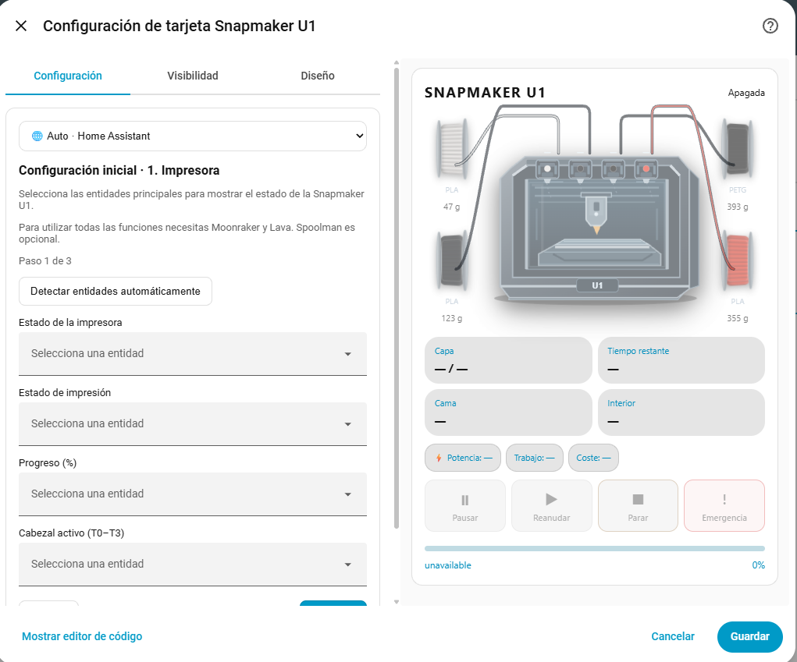
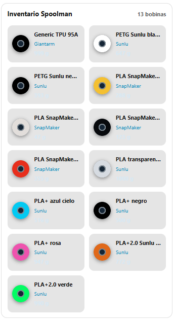

# Snapmaker U1 Card

**Documentation / Documentación:** [English](#english) · [Español](#español)

[](https://my.home-assistant.io/redirect/hacs_repository/?owner=sergey08&repository=snapmaker-u1-card&category=plugin)

**Install via HACS / Instalar mediante HACS:** Click the button above to open the repository in Home Assistant. / Pulsa el botón para abrir el repositorio en Home Assistant. If it is not registered yet, add `https://github.com/sergey08/snapmaker-u1-card` as a custom **Dashboard** repository. / Si todavía no está registrado, añádelo como repositorio personalizado de tipo **Dashboard**.

---

<a id="english"></a>

**A four-toolhead dashboard for Snapmaker U1 in Home Assistant.** Monitor print progress, temperatures, filament, cameras and electricity, and manage supported printer controls from one Lovelace card.

**Español:** Tarjeta para Home Assistant dedicada a la Snapmaker U1: cuatro cabezales, progreso, temperaturas, bobinas, cámaras, consumo y controles de impresión.



> **Stable release / Versión estable:** [v0.1.0](https://github.com/sergey08/snapmaker-u1-card/releases/tag/v0.1.0). The previous beta remains available. / La versión beta anterior sigue disponible.

## What's new in v0.1.2 / Novedades de v0.1.2

### English

- **Optional printer LED control:** select a Home Assistant `light` entity using the visual editor's **Printer LED light** field (`led_light_entity`).
- **Lightbulb button:** tap to turn the printer light on or off. The bulb appears dim/grey when off and illuminated when on.
- **Brightness slider (0–100%):** moving above 0% turns the light on and applies the chosen brightness; moving to 0% turns it off. When off, the slider returns to 0%; when on, it reflects the actual brightness reported by Home Assistant.
- **Moonraker compatibility:** when the light is off, the card first sends `light.turn_on` and then applies `brightness_pct`, accommodating devices that cannot start directly at a specified brightness.
- **Conditional update notice:** configure `update_available_sensor` (for example, `binary_sensor.update_available_lava`). The notice appears only when the sensor is `on` and remains completely hidden otherwise.
- Both features are optional and do not affect cards without these entities. The LED must support Home Assistant light services; brightness availability depends on the integration.

### Español

- **Control LED opcional:** selecciona una entidad `light` desde el campo **Luz LED de la impresora** del editor visual (`led_light_entity`).
- **Bombilla interactiva:** pulsa para encender o apagar. Se muestra gris y atenuada cuando está apagada, e iluminada cuando está encendida.
- **Barra de brillo (0–100 %):** por encima del 0 % enciende y ajusta la intensidad; al 0 % apaga. Apagada, la barra vuelve al 0 %; encendida, refleja el brillo real comunicado por Home Assistant.
- **Compatibilidad con Moonraker:** al encender desde la barra, primero se ejecuta `light.turn_on` y después se aplica `brightness_pct`, para integraciones que no admiten arrancar directamente con una intensidad determinada.
- **Aviso de actualización condicional:** configura `update_available_sensor` (por ejemplo, `binary_sensor.update_available_lava`). Solo se muestra cuando el sensor está en `on`; en cualquier otro estado no ocupa espacio.
- Ambas funciones son opcionales. La entidad LED debe admitir los servicios de luz de Home Assistant; la regulación depende de la integración.

### Example configuration / Ejemplo de configuración

```yaml
type: custom:snapmaker-u1-card
led_light_entity: light.led_cavity_led_snapmaker_u1_despacho
update_available_sensor: binary_sensor.update_available_lava
```

Replace these example entity IDs with your own; keep the rest of your existing card configuration. / Sustituye las entidades del ejemplo por las tuyas y conserva el resto de la configuración actual.

## Screenshots / Capturas de pantalla

These are genuine screenshots of the approved light/cyan Home Assistant design. / Capturas reales del diseño claro y azul cian aprobado en Home Assistant.

### Full dashboard / Vista completa


### Compact mode / Modo compacto


### Initial setup wizard / Asistente de configuración inicial


The setup wizard preview is not yet connected to printer entities, so it may show unavailable values. / La vista previa del asistente aún no tiene entidades asignadas, por lo que puede mostrar valores no disponibles.

### Spoolman inventory / Inventario Spoolman


## Features / Funciones

- Four toolheads (T0–T3), temperatures and active tool / Cuatro cabezales, temperaturas y herramienta activa.
- Print status, progress, layers, estimated time and an in-job thumbnail / Estado, progreso, capas, tiempo estimado y miniatura integrada en el trabajo actual.
- Optional live camera; the print thumbnail is displayed inside the current-job panel without a duplicate preview section / Cámara en directo opcional; la miniatura aparece dentro del trabajo actual sin una sección duplicada.
- Optional Lava filament presence and job estimates / Presencia de filamento y estimaciones opcionales mediante Lava.
- Optional Spoolman spool colors, weights and inventory / Colores, pesos e inventario opcional mediante Spoolman.
- Optional power and electricity cost / Potencia y coste eléctrico opcionales.
- Print controls with confirmation for destructive actions / Controles con confirmación para acciones destructivas.
- Optional LED lightbulb and 0–100% brightness slider, synchronized with Home Assistant / Bombilla LED y barra de brillo 0–100 % opcionales, sincronizadas con Home Assistant.
- Update notification shown only when an update is available / Aviso visible únicamente cuando hay una actualización disponible.
- Visual editor, three-step setup wizard and read-only entity auto-detection / Editor visual, asistente de tres pasos y detección de entidades de solo lectura.
- Language selector with automatic Home Assistant locale detection: English, Spanish, Portuguese, French, German, Italian and Dutch (translation coverage is still being completed). / Selector de idioma con detección automática: inglés, español, portugués, francés, alemán, italiano y neerlandés (traducciones todavía en revisión).
- Light/dark Home Assistant theme-aware design with cyan-blue accents / Diseño adaptable al tema claro/oscuro y acentos azul cian.

## Requirements / Requisitos

For the **full Snapmaker U1 Card experience**, configure **Moonraker and Lava** in Home Assistant. **Spoolman is optional**. / Para disfrutar de **todas las funciones de Snapmaker U1 Card**, configura **Moonraker y Lava** en Home Assistant. **Spoolman es opcional**.

| Component / Componente | Requirement / Requisito | What it provides / Qué aporta |
| --- | --- | --- |
| **Home Assistant** | **Required / Obligatorio** | Lovelace dashboard and entity configuration / Panel Lovelace y configuración de entidades |
| **[Moonraker (Home Assistant)](https://github.com/marcolivierarsenault/moonraker-home-assistant)** | **Required for core printing features / Necesario para las funciones principales de impresión** | Printer status, print progress, temperatures and compatible controls / Estado, progreso, temperaturas y controles compatibles |
| **[Lava / U1 Companion](https://github.com/zkasuran/u1-companion)** | **Required for full U1-specific functionality / Necesario para todas las funciones específicas de U1** | Snapmaker U1-specific toolhead and filament information / Información específica de los cuatro cabezales y filamentos |
| **[Spoolman](https://github.com/Donkie/Spoolman)** | **Optional / Opcional** | Filament inventory, spool colors, weights and remaining material / Inventario de filamento, colores, pesos y material restante |
| Camera entities / Entidades de cámara | Optional / Opcional | Live camera and current-job thumbnail when entities are available / Cámara en directo y miniatura del trabajo actual cuando existen entidades |
| Power, energy and electricity-price entities / Entidades de potencia, energía y precio | Optional / Opcional | Electricity consumption and estimated cost / Consumo eléctrico y coste estimado |

**Component links / Enlaces a componentes:** The Moonraker link points to its Home Assistant integration; Spoolman points to its official project. Lava / U1 Companion links to its project repository. / Lava / U1 Companion enlaza a su repositorio del proyecto.

**Important / Importante:** The card reads entities exposed in Home Assistant; installing the card alone does not install or configure Moonraker, Lava or Spoolman. The available features depend on the entities provided by those integrations and their configured mappings. / La tarjeta utiliza las entidades disponibles en Home Assistant: instalarla no instala ni configura Moonraker, Lava o Spoolman. Las funciones disponibles dependen de las entidades que expongan esas integraciones y de su asignación.

**Without Spoolman / Sin Spoolman:** The printer status and printing controls can still work with Moonraker and Lava; only the optional inventory functionality is unavailable. / El estado y los controles de impresión pueden seguir funcionando con Moonraker y Lava; únicamente faltará el inventario opcional.

## Installation / Instalación

### Development preview / Versión de pruebas

1. Make the JavaScript file `snapmaker-u1-card.js` available to Home Assistant as a Lovelace JavaScript module resource. / Añade el archivo como recurso JavaScript de tipo módulo en Lovelace.
2. Add **Snapmaker U1 Card** from the card picker, or use the YAML below. / Añade la tarjeta desde el selector o utiliza este YAML:

```yaml
type: custom:snapmaker-u1-card
```

3. In the initial wizard, select **Auto-detect entities / Detectar entidades automáticamente**. Review all matches before finishing. / Revisa las entidades detectadas antes de finalizar.
4. Complete any optional entities in the advanced editor. / Completa las entidades opcionales desde el editor avanzado.

### HACS custom repository / Repositorio personalizado HACS

The repository includes `hacs.json` and can be added as a **custom dashboard repository** in HACS. / El repositorio incluye `hacs.json` y puede añadirse como **repositorio personalizado de tipo Dashboard** en HACS.

1. Open **HACS → ⋮ → Custom repositories** / Abre **HACS → ⋮ → Repositorios personalizados**.
2. Add `https://github.com/sergey08/snapmaker-u1-card` with category **Dashboard** / Añade esa URL con categoría **Dashboard**.
3. Install the card and add `custom:snapmaker-u1-card` to a dashboard / Instala la tarjeta y añádela al panel.

**Stable release available / Versión estable disponible:** [v0.1.0](https://github.com/sergey08/snapmaker-u1-card/releases/tag/v0.1.0). Official HACS catalog inclusion remains pending. / Sigue pendiente la inclusión en el catálogo oficial de HACS.

## Beta release process / Publicación de la beta

The beta workflow runs when a matching tag (`v*-beta.*`) is pushed or manually using **Run workflow** with an existing tag. It validates the card and screenshots, then creates or updates the GitHub pre-release and attaches `snapmaker-u1-card.js`. / El flujo se ejecuta al crear una etiqueta `v*-beta.*` o manualmente con **Run workflow** indicando una etiqueta existente. Valida la tarjeta y las capturas, crea o actualiza la versión preliminar y adjunta `snapmaker-u1-card.js`.

The first beta has been published; see [BETA_CHECKLIST.md](BETA_CHECKLIST.md) for remaining installation and live-print acceptance tests. / La primera beta ya está publicada; consulta [BETA_CHECKLIST.md](BETA_CHECKLIST.md) para las pruebas pendientes de instalación e impresión real.

## Stable releases and HACS versions / Versiones estables y HACS

The manually triggered [Publish stable release](.github/workflows/stable-release.yml) workflow validates the card and publishes a versioned GitHub release, starting with `v0.1.0`, without moving existing tags. Do not publish it before completing acceptance tests. Once published, refresh the repository information in HACS and install the tagged release. / El flujo manual **Publish stable release** valida la tarjeta y publica una versión numerada en GitHub, empezando por `v0.1.0`, sin modificar etiquetas existentes. No debe ejecutarse hasta completar las pruebas de aceptación. Después, actualiza la información del repositorio en HACS e instala la versión etiquetada.

## Safety / Seguridad

Automatic detection only reads Home Assistant state; it does not execute printer actions. / La detección automática solo lee estados de Home Assistant y no ejecuta acciones.

Printer controls can execute real actions once configured. Verify entity mappings before using them. / Los controles pueden ejecutar acciones reales; comprueba las entidades antes de utilizarlos.

## Development status / Estado del desarrollo

The wizard and auto-detection have been validated on one Home Assistant installation. The current card styling has been reviewed in light mode. Translation coverage, cross-browser testing, HACS installation testing, live-print controls and multi-printer matching still need further validation. / El asistente y la detección se han validado en una instalación y el diseño claro se ha revisado. Aún hay que ampliar la cobertura de traducciones y validar la instalación por HACS, los controles durante una impresión real, distintos navegadores y varias impresoras.

## License

MIT.

---

<a id="español"></a>

# Español

**Tarjeta para Home Assistant dedicada a la impresora 3D Snapmaker U1.** Permite consultar el estado de impresión, controlar los cuatro cabezales, visualizar temperaturas, filamentos, cámara y consumo eléctrico, y ejecutar los controles compatibles desde un único panel.

**Idiomas disponibles en este mismo README:** español e inglés.

**Versión estable actual: [v0.1.0](https://github.com/sergey08/snapmaker-u1-card/releases/tag/v0.1.0).** Instalación mediante HACS como repositorio personalizado de tipo **Dashboard**.


## Capturas de pantalla

### Vista completa


### Vista compacta


### Asistente de configuración


### Inventario de Spoolman


## Funcionalidades

**Novedades de v0.1.2:** control LED con bombilla y brillo del 0 al 100 %, sincronización automática del estado y aviso de actualización que permanece oculto si no hay novedades. Consulta [la documentación detallada en español e inglés](#whats-new-in-v012--novedades-de-v012).


- **Cuatro cabezales T0, T1, T2 y T3:** temperaturas, herramienta activa e información de filamento.
- **Seguimiento de impresión:** estado, progreso, capas, tiempo estimado y miniatura del trabajo actual.
- **Cámara opcional:** imagen en directo si Home Assistant dispone de la entidad correspondiente.
- **Spoolman opcional:** inventario, materiales, colores, pesos y filamento restante.
- **Consumo eléctrico opcional:** potencia, energía y coste estimado según las entidades configuradas.
- **Controles de impresión:** acciones compatibles con confirmación para operaciones potencialmente destructivas.
- **Control de luz LED opcional:** bombilla interactiva, brillo regulable de 0 a 100 % y sincronización con el estado real de Home Assistant.
- **Aviso de actualizaciones opcional:** aparece solo cuando el sensor indica una actualización disponible.
- **Editor visual y asistente inicial de tres pasos**, con detección automática de entidades y revisión de las asignaciones.
- **Diseño claro y oscuro**, adaptado al tema de Home Assistant, con modo completo y compacto.
- **Idiomas:** español, inglés, portugués, francés, alemán, italiano y neerlandés. Algunas traducciones siguen en revisión.

## Requisitos

| Componente | Necesidad | Función |
| --- | --- | --- |
| Home Assistant | Obligatorio | Panel y entidades |
| [Moonraker (Home Assistant)](https://github.com/marcolivierarsenault/moonraker-home-assistant) | Necesario para las funciones principales | Estado, temperaturas, progreso y controles compatibles |
| [Lava / U1 Companion](https://github.com/zkasuran/u1-companion) | Necesario para las funciones específicas de U1 | Información de cabezales y filamentos |
| [Spoolman](https://github.com/Donkie/Spoolman) | Opcional | Inventario, colores y cantidades de filamento |
| Entidad de cámara | Opcional | Vídeo o imagen en directo |
| Sensores eléctricos | Opcional | Consumo y coste |

**Enlaces:** Moonraker enlaza a su integración para Home Assistant; Spoolman, a su repositorio oficial. Lava / U1 Companion enlaza a su repositorio en GitHub.

**Importante:** instalar la tarjeta no instala Moonraker, Lava ni Spoolman. Estas integraciones deben estar configuradas por separado y exponer sus entidades en Home Assistant. Sin Spoolman, las funciones principales de impresión pueden seguir funcionando.

## Instalación con HACS

1. Abre **HACS** en Home Assistant.
2. En el menú de los tres puntos, selecciona **Repositorios personalizados**.
3. Introduce `https://github.com/sergey08/snapmaker-u1-card`.
4. Selecciona la categoría **Dashboard** y añade el repositorio.
5. Instala **Snapmaker U1 Card**, preferiblemente la versión estable **v0.1.0**.
6. Añade la tarjeta desde el selector de tarjetas o utiliza:

```yaml
type: custom:snapmaker-u1-card
```

7. Abre el asistente de configuración, pulsa **Detectar entidades automáticamente** y revisa las correspondencias antes de guardar.
8. Si el navegador sigue mostrando una versión anterior, recarga con **Ctrl + Shift + R**.

**Actualizaciones:** las versiones estables se publican con etiquetas `v0.1.0`, `v0.1.1`, etc. HACS permite instalar las actualizaciones disponibles. La inclusión en el catálogo oficial de HACS sigue pendiente; por ahora se utiliza el repositorio personalizado.

## Configuración y uso

El asistente intenta identificar automáticamente las entidades de Moonraker, Lava y los componentes opcionales. Si alguna no se detecta, puede asignarse manualmente desde el editor visual. Los sensores que no existan pueden dejarse sin configurar cuando sean opcionales.

Durante la impresión, la tarjeta muestra la información disponible del trabajo y del cabezal activo. Cuando la impresora está inactiva o desconectada, algunas entidades pueden mostrar valores no disponibles; esto no significa necesariamente que la tarjeta esté averiada.

**Seguridad:** la detección automática solo consulta estados; no ejecuta acciones. Antes de utilizar los botones de control, comprueba las entidades asignadas.

## Estado del proyecto

**v0.1.0 está publicada e instalada correctamente mediante HACS en una instalación real de Home Assistant.** Quedan pendientes pruebas adicionales durante una impresión real, comprobaciones en otros navegadores y configuraciones con varias impresoras, así como completar algunas traducciones.

La primera beta `v0.1.0-beta.1` sigue disponible en [versiones publicadas](https://github.com/sergey08/snapmaker-u1-card/releases). El procedimiento de publicación y validación se mantiene en los flujos de GitHub Actions del repositorio.

## Soporte y desarrollo

Para informar de errores o proponer mejoras, utiliza [GitHub Issues](https://github.com/sergey08/snapmaker-u1-card/issues).

**Licencia:** MIT.
